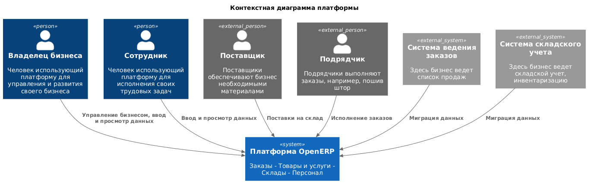

# Границы и контекст продукта

- **Версия:** 0.1
- **Статус:** Черновик
- **Дата изменения:** 17.10.2026

## Назначение документа

Документ определяет предварительные границы OpenERP, участников
взаимодействия с системой, внешние информационные системы и основные
направления обмена информацией. Документ используется как основа для
дальнейшего исследования бизнес-процессов и формирования требований.

## Контекст создания продукта

OpenERP создается из идеи развития полноценных технических и
управленческих навыков руководителя проекта. Первичная цель OpenERP
стать продуктом способным автоматизировать мелкий бизнес и понравиться
руководителю, который не имеет представления и понимания зачем
внедрять автоматизированные системы в бизнес, считает это сложным
и\или дорогим, не видит преимуществ.

Первым пользователем системы должен стать розничный магазин по пошиву
штор, продаже карнизов и пошиву под ключ с выездом дизайнера. А также
создатель текущей платформы, предоставляющий услуги по внедрению
платформы в бизнес.

Развитие прдукта планируется по мере роста понимания различных сфер
бизнема, разных его типов и потребностей. Развитие подразумевает
расширение функций для автоматизации различных аспектов управление и
сопровождения бизнеса включая: покупки, продажи, аудит, закупки,
менеджмент, расширенная аналитика бизнеса.

## Пользователи и внешние участники

| Участник  | Как взаимодействует с платформой                                                          | Что нужно выяснить                    |
|:----------|:------------------------------------------------------------------------------------------|:--------------------------------------|
| Владелец  | Управляет деятельностью, просматривает складские остатки, товары, услуги, продажи, заказы | Что действительно хочет владелец      |
| Сотрудник | Работает с заказами, задачами или запасами, клиентами                                     | Какие части системы нужны сотруднику? |
| Клиент    | Не взаимодействует с системой                                                             | Нужно ли взаимодействие в будущем?    |
| Подрядчик | Выполняет работы                                                                          | Как ээто отображается в системе?      |

## Границы продукта

Функции:

1. Управление заказами
2. Управление списком сотрудников
3. Управление списком предприятий
4. Управление учетными записями пользователей системы.
5. Управление списком складов
   - Ведение складских остатков
6. Управление списком продуктов
   - Ведение списка товаров
   - Ведение списка услуг
7. Мониторинг и аудит операций в системе
   - Мониторинг состояния инфраструктуры и бизнес функций
   - Аудит операций с учетными записями
8. Управление списком поставщиков

## Внешние системы и взаимодействия

**Тетрадь:** ведение заказов, товаров
**Лично\Телефон:** общение с клиентами
**Мессенджер\Соц.сеть:** общение с клиентами
**Приложение банка:** бухгалтерия, управление финансами

## Предварительные допущения и ограничения

- разработку первоначально выполняет один Java-разработчик;
- ресурсы на разработку ограничены;
- салон штор является первой средой исследования;
- переносимость решений на другие предприятия требует отдельной проверки;
- необходимость интеграции с существующей программой учёта пока не установлена.

## Открытые вопросы

- Какие данные и где ведутся?
- Как распределяются заказы?
- Какие роли выполняет 1 сотрудник?
- Какие сведения и где хранятся о клиентах?

## Контекстная диаграмма

