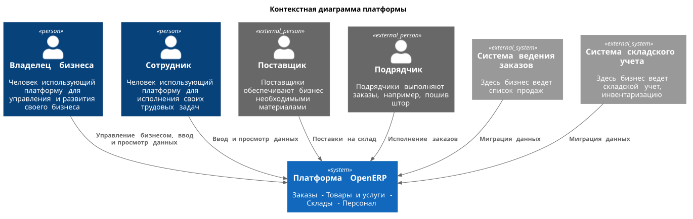
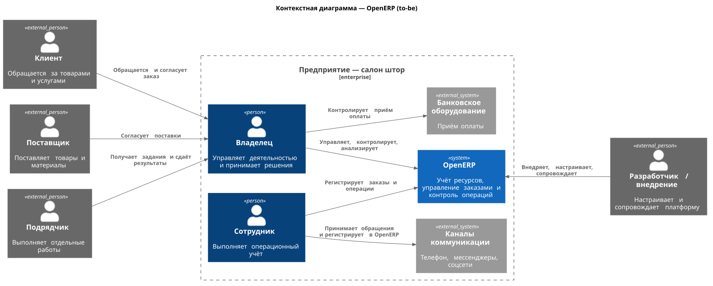

# Границы и контекст продукта

- **Версия:** 0.1
- **Статус:** Черновик
- **Дата изменения:** 17.10.2026

## Назначение документа

Документ определяет предварительные границы OpenERP, участников
взаимодействия с системой, внешние информационные системы и основные
направления обмена информацией. Документ используется как основа для
дальнейшего исследования бизнес-процессов и формирования требований.

## Контекст создания продукта

OpenERP разрабатывается как платформа для упорядочивания операционной
деятельности малых предприятий и постепенной автоматизации их
бизнес-процессов.

Продукт ориентирован в том числе на предпринимателей, которые пока не
используют специализированные системы управления бизнесом из-за
предполагаемой стоимости, сложности внедрения или недостаточного
понимания практической пользы автоматизации.

Первой практической средой для исследования и проверки продуктовых
решений станет салон штор, занимающийся продажей карнизов, пошивом
штор и комплексным обслуживанием клиентов, включая выезд дизайнера.

На начальном этапе развитие платформы будет определяться реальными
потребностями этого предприятия. При этом решения должны
проектироваться с учётом возможности дальнейшей адаптации к другим
типам бизнеса. Специфические процессы салона штор не должны без
необходимости становиться обязательными правилами платформы.

В дальнейшем предполагается исследовать потребности других предприятий
и постепенно расширять возможности управления заказами, ресурсами,
закупками, продажами и бизнес-процессами.

Разработка OpenERP также является практическим проектом для развития
компетенций в области системного анализа, проектирования программной
архитектуры и управления разработкой.

## Пользователи и внешние участники

| Участник                              | Роль в контексте OpenERP                                           | Что необходимо определить                                                |
|:--------------------------------------|:-------------------------------------------------------------------|:-------------------------------------------------------------------------|
| Владелец предприятия                  | Основной пользователь; управляет деятельностью и принимает решения | Какие данные и операции нужны ему ежедневно?                             |
| Сотрудник                             | Пользователь, выполняющий операционные действия                    | Какие функции нужны с учётом его обязанностей?                           |
| Разработчик / специалист по внедрению | Настраивает, внедряет, сопровождает и развивает платформу          | Какие инструменты настройки и администрирования необходимы?              |
| Клиент предприятия                    | Получатель товаров и услуг предприятия                             | Нужно ли когда-либо предоставлять клиенту прямой доступ к системе?       |
| Поставщик                             | Внешний участник закупок и поставок                                | Достаточно ли фиксировать взаимодействие силами сотрудников предприятия? |
| Подрядчик                             | Внешний исполнитель отдельных работ                                | Как учитывать назначенные работы, сроки и результаты?                    |

## Границы продукта

OpenERP рассматривается как платформа, предназначенная для
последовательной цифровизации операционной деятельности
предприятия. Функциональность должна развиваться от базового учёта к
контролю исполнения, аналитике и автоматизации бизнес-процессов.

На текущем этапе выделены следующие функциональные направления.

### 1. Управление организациями и доступом

- управление организациями, использующими платформу;
- управление сотрудниками;
- управление учётными записями пользователей;
- разграничение доступа к функциям и данным;
- аудит действий пользователей и операций с учётными записями.

Поддержка нескольких независимых организаций рассматривается как
направление развития платформы. Необходимость включения этой
возможности в первую версию должна быть определена отдельно.

### 2. Управление товарами и услугами

- ведение каталога продуктов;
- ведение перечня товаров и их характеристик;
- ведение перечня услуг;
- обеспечение использования единого каталога при оформлении заказов и
  выполнении других операций.

Продукт рассматривается как общее понятие, объединяющее товары и
услуги. Конкретный состав характеристик и правила учёта должны
определяться предметной областью.

### 3. Управление заказами и исполнением работ

- регистрация и просмотр заказов;
- фиксация состояния заказа и связанных с ним данных;
- учёт исполнителей, сроков и результатов работ;
- возможность постепенного внедрения настраиваемых этапов выполнения
  заказа.

Платформа не должна ограничиваться заранее заданным отраслевым
сценарием. Конкретные этапы и правила выполнения работ должны
определяться потребностями предприятия.

### 4. Управление складами и запасами

- ведение перечня складов;
- учёт складских остатков;
- фиксация операций поступления, перемещения и списания товаров и
  материалов;
- получение информации о наличии ресурсов, необходимых для выполнения
  заказов.

Детальные правила складского учёта и порядок работы с материалами
должны быть уточнены в ходе исследования.

### 5. Управление поставщиками и закупками

- ведение перечня поставщиков;
- фиксация сведений о закупках и поставках;
- связь закупок с товарами, материалами и складскими операциями;
- возможность анализа закупочной деятельности в дальнейшем.

### 6. Контроль, аудит и аналитика

- регистрация значимых действий пользователей;
- аудит операций с данными;
- контроль состояния бизнес-операций;
- формирование управленческих отчётов;
- мониторинг технического состояния платформы и её ключевых функций.

Аудит бизнес-операций, аудит доступа и технический мониторинг являются
разными задачами и могут реализовываться на разных этапах развития
продукта.

### Приоритеты реализации

Перечисленные направления определяют область развития OpenERP, но не
являются утверждённым объёмом MVP.

Приоритет первой версии определяется по результатам исследования
первого предприятия, оценки бизнес-ценности, трудоёмкости реализации и
рисков внедрения.

Платформа должна развиваться постепенно, сохраняя возможность
расширения функциональности и адаптации общих механизмов к различным
типам предприятий.

## Внешние системы и взаимодействия

В настоящее время операционная деятельность предприятия
преимущественно организована с использованием бумажных записей и
средств коммуникации. Специализированная компьютерная система для
ведения заказов и складского учёта не используется.

| Инструмент или канал          | Текущее назначение                                              | Предполагаемое взаимодействие с OpenERP                                                                 |
|:------------------------------|:----------------------------------------------------------------|:--------------------------------------------------------------------------------------------------------|
| Бумажная тетрадь              | Фиксация заказов и отдельных сведений о товарах                 | Перенос учёта в OpenERP; необходимость переноса исторических записей определяется отдельно              |
| Личное общение и телефон      | Приём обращений и взаимодействие с клиентами                    | Регистрация сведений о клиентах и заказах сотрудниками                                                  |
| Мессенджеры и социальные сети | Общение с клиентами и получение обращений                       | Первоначально возможна ручная регистрация обращений; автоматическая интеграция рассматривается отдельно |
| Банковская касса или терминал | Проведение расчётов с использованием банковского оборудования   | Назначение оборудования и доступность данных для интеграции требуют уточнения                           |
| Прочие инструменты            | Возможные дополнительные способы хранения и передачи информации | Выявляются в ходе исследования процессов предприятия                                                    |

### Предполагаемые направления интеграции

В перспективе могут рассматриваться интеграции с банковскими
сервисами, средствами коммуникации, бухгалтерскими системами и другими
внешними приложениями.

Интеграция не является обязательным условием первой версии. Приоритет
определяется тем, какую бизнес-задачу она решает, насколько часто
используется соответствующий канал и какие технические возможности
предоставляет внешняя система.

OpenERP должна быть полезна и при отсутствии интеграций, позволяя
предприятию постепенно переходить от ручного учёта к структурированным
данным.

## Предварительные допущения и ограничения

- разработку первоначально выполняет один Java-разработчик;
- ресурсы на разработку ограничены;
- салон штор является первой средой исследования;
- переносимость решений на другие предприятия требует отдельной проверки;
- необходимость интеграции с существующей программой учёта пока не установлена.

## Открытые вопросы

- Какие данные и где ведутся?
- Как распределяются заказы?
- Какие роли выполняет 1 сотрудник?
- Какие сведения и где хранятся о клиентах?

## Контекстная диаграмма

### AS IS

### TO BE

